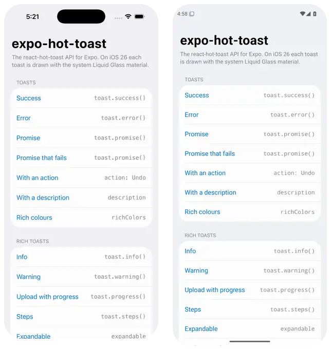
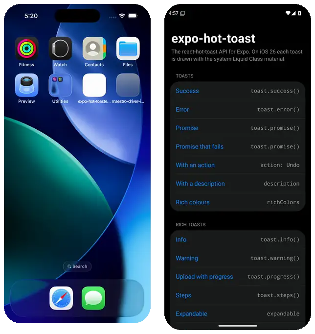

# expo-hot-toast

[](https://github.com/VanitasCaesar1/expo-hot-toast/actions/workflows/ci.yml)
[](https://github.com/VanitasCaesar1/expo-hot-toast/actions/workflows/ios.yml)
[](https://github.com/VanitasCaesar1/expo-hot-toast/actions/workflows/android.yml)
[](./LICENSE)

Toasts for Expo and React Native, with the react-hot-toast API. On iOS 26 each
toast is drawn in Apple's own Liquid Glass, on Android as a Material 3
snackbar, and on the web in frosted glass. Beyond plain toasts: progress,
steps, Undo with a countdown, notifications, a HUD and a Dynamic Island
capsule. Plain React web apps get the same API through `expo-hot-toast/web`.

**[Try it on the website](https://vanitascaesar1.github.io/expo-hot-toast/)**: every
button there fires a real toast, from this library running in your browser.

<p align="center">
  <picture>
    <source media="(prefers-color-scheme: dark)" srcset="./docs/media/demo-dark.webp" />
    
  </picture>
  <br />
  <sub>iPhone (iOS 26.5, Liquid Glass) and Android 15 (Material 3), screen recordings from CI</sub>
</p>

**[Documentation](https://vanitascaesar1.github.io/expo-hot-toast/docs/)** ·
[Website](https://vanitascaesar1.github.io/expo-hot-toast/)

## Install

Not on npm yet; install from GitHub, then add the peer dependencies:

```sh
npm install github:VanitasCaesar1/expo-hot-toast
npx expo install expo-glass-effect expo-haptics react-native-reanimated \
  react-native-worklets react-native-gesture-handler \
  react-native-safe-area-context react-native-svg
```

[Installation](./docs/guide/installation.md) covers the app root and
React Native without Expo.

## Use

Mount one `<Toaster />` at the root, then call `toast` from anywhere:

```tsx
import { Toaster, toast } from 'expo-hot-toast';

export default function App() {
  return (
    <>
      <Home />
      <Toaster />
    </>
  );
}

toast.success('Changes saved');
toast.error('Could not reach the server');
toast('Message archived', { action: { label: 'Undo', onPress: restore } });

await toast.promise(upload(photo), {
  loading: 'Uploading photo…',
  success: 'Photo uploaded',
  error: 'Upload failed',
});
```

## What you get

- **Liquid Glass on iOS 26**, through `expo-glass-effect`. Older iOS, Android
  and Reduce Transparency get an opaque surface; nothing imitates glass. The
  web gets frosted glass, a CSS backdrop blur.
- **A queue.** Three toasts per position; the rest wait, and get their full time
  once they show.
- **Gestures.** Swipe to dismiss; press and hold to pause every timer.
- **Actions, a close button and deduplication**, so Undo works and twenty
  identical calls show one toast.
- **More than a line of text**: progress bars and rings that fill on the UI
  thread, named steps, expandable details, Undo with a countdown, cancel and
  confirm, notifications with an avatar, banners, a HUD and a Dynamic Island
  capsule. See [Rich toasts](./docs/guide/rich-toasts.md).
- **Plain React web apps too**: `expo-hot-toast/web` is the same API in
  Next.js or Vite, drawn with DOM and CSS in the same frosted glass, with no
  React Native. See [Web apps](./docs/guide/web.md).
- **Native by default, yours if you want**: a Material 3 snackbar on Android and
  the glass pill on iOS, or one everywhere; your own icons; a style or
  NativeWind class for every part; or no built-in look at all. Themes from React
  Navigation or a few colours. See [Customising](./docs/guide/customizing.md).
- **Accessibility**: screen reader announcements, Reduce Motion, Reduce
  Transparency, Bold Text, capped text size, and haptics for outcomes.
- **Tokens** for every colour, size and duration, in light and dark.

## More than a line of text

<p align="center">
  
  <br />
  <sub>Progress, steps, Undo with a countdown, a notification, the island, a HUD and a banner. Recorded in CI.</sub>
</p>

```tsx
const upload = toast.progress('Uploading 4 photos');
upload.set(0.4);                       // on the UI thread, no re-render
upload.success('4 photos uploaded');

toast.steps(['Compressing video', 'Uploading', 'Processing']);
toast('Conversation deleted', { action: { label: 'Undo', countdown: true, onPress: restore } });
toast.notify({ title: 'Maya Patel', body: 'Sent you 4 photos', avatar: { uri } });
toast.hud('Added to Library');
toast.island('AirPods Pro connected', { type: 'success' });
```

See [Rich toasts](./docs/guide/rich-toasts.md).

## Coming from react-hot-toast

react-hot-toast is web-only: it renders DOM elements. This package rebuilds its
API on native views, so toast code from a React web app ports by changing the
import. [The differences](./docs/guide/coming-from-react-hot-toast.md) fit on one
page.

## Platform support

| Platform | Surface | Tested |
|---|---|---|
| iOS 26 | Liquid Glass | iOS 26.5 simulator in CI |
| Android | Material 3 snackbar, opaque | Android 15 emulator in CI |
| iOS before 26 | Opaque | Not yet |
| Web | Frosted glass | Built for the web in CI; runs the website's demos |

Requires Expo SDK 55 or later (tested on 57). Liquid Glass needs an app built
with Xcode 26 or later.

## Contributing

Issues and pull requests are welcome. [CONTRIBUTING.md](./CONTRIBUTING.md) covers
setup and the test gates. [docs/design.md](./docs/design.md) explains the
decisions behind the queue, the timing and the glass.

## License

MIT
